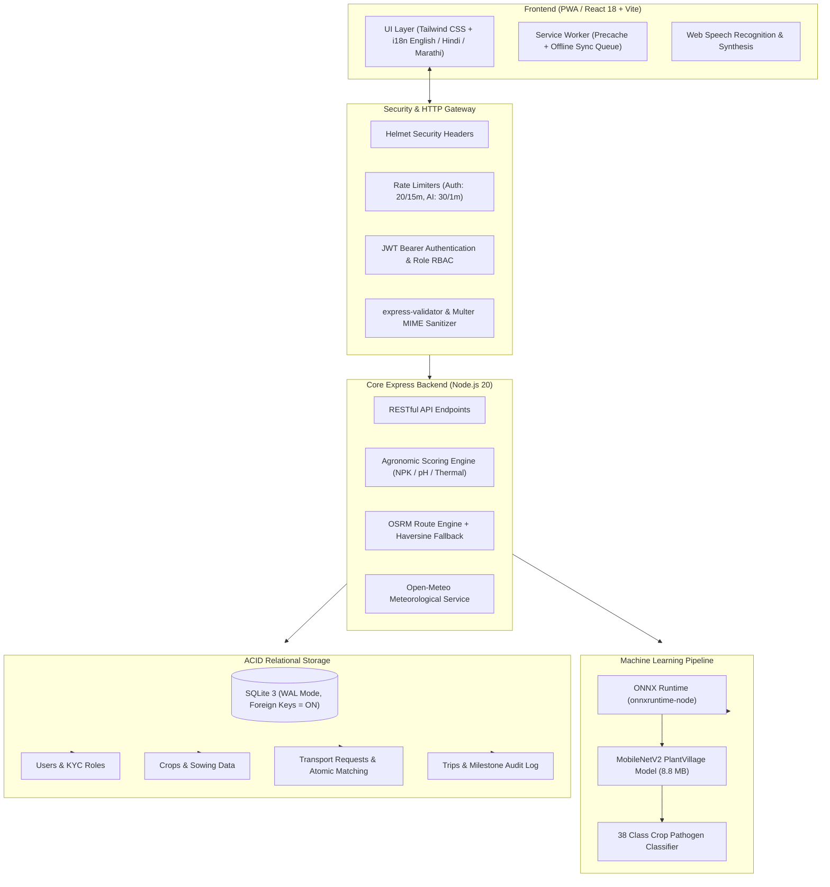

# KrishiDrive v2.1.0

> **Fair, transparent agricultural transport logistics and verified agronomy for Indian farmers.**

[](https://github.com/SRUJAN17-MK/KrishiDrive/actions/workflows/ci.yml)
[](LICENSE)
[](https://nodejs.org/)
[-blue.svg)](https://www.sqlite.org/)
[-orange.svg)](https://onnxruntime.ai/)

KrishiDrive is an open-source agricultural logistics and crop management platform designed for rural Indian farmers, transporters, and agricultural produce market committees (APMCs). It pairs field-level dispatch needs with nearby haulers, provides real-world road routing and live weather, calculates agronomic recommendations using established ICAR soil chemistry formulas, and runs genuine on-device crop disease inference using ONNX Runtime.

---

## What's New in v2.1.0

The v2.1.0 engineering upgrade replaces mock prototypes and unverified marketing claims with honest, verifiable engineering:

| Subsystem | v2.0.0 (Legacy) | v2.1.0 (Production Upgrade) |
| :--- | :--- | :--- |
| **Crop Disease Diagnosis** | `file.size % pool.length` mock | **Actual MobileNetV2 ONNX model** (PlantVillage-trained, 38 classes, CPU inference) |
| **Model Transparency** | Fabricated 45 TOPS / 12ms claims | **Real benchmarked latency** (3.3 ms avg inference, CPU execution provider) |
| **Database & ACID** | JSON files on disk (`fs.writeFileSync`) | **SQLite with WAL mode**, foreign keys, transactional booking & concurrency locks |
| **Route Optimization** | Aerial Haversine × 1.28 | **OSRM road network routing** (actual highway distance, duration & geometry) with labelled fallback |
| **Live Weather** | Hardcoded JSON city dictionaries | **Live Open-Meteo meteorological API** (current temperature, humidity, wind, rainfall) |
| **Market Prices** | Fabricated prices | **Agmarknet schema integration** via data.gov.in (never generates fake mandi prices) |
| **Security** | Missing rate-limit, Helmet & validation | **Helmet headers**, `express-rate-limit`, `express-validator`, upload MIME validation |
| **Accessibility & i18n** | English only | **English, Hindi (हिंदी), and Marathi (मराठी)** + Voice input & Text-to-Speech |
| **Offline Reliability** | Online only | **PWA Service Worker**, offline navigation, indexed action queue for reconnect sync |

---

## System Architecture



---

## Core Modules & Verifiable Features

### 1. Honest AI & Agronomic Engine
- **Crop Disease Classification (`POST /api/ai/crop-disease-detection`)**:
  - Model architecture: MobileNetV2 (9.2 MB ONNX weights, 38 PlantVillage crop pathogen classes).
  - Preprocessing: Standard RGB normalization ($224 \times 224$, mean `[0.485, 0.456, 0.406]`, std `[0.229, 0.224, 0.225]`).
  - Output: Top-1 predicted disease class, confidence score ($0.0 - 1.0$), top-5 distribution, and curative agronomic advisory.
  - **Honest Execution Provider**: Runs on CPU via `onnxruntime-node`. NPU execution is **only** reported when verified on supported Qualcomm QNN hardware.
- **Agronomic Scoring Engine (`POST /api/ai/crop-recommendation`)**:
  - Deterministic multi-factor scoring based on Indian Council of Agricultural Research (ICAR) guidelines.
  - Evaluates Nitrogen (N), Phosphorus (P), Potassium (K), soil pH, ambient temperature, humidity, and rainfall against crop physiological tolerance bands.
- **Harvest & Economic Estimator (`POST /api/ai/harvest-prediction`)**:
  - Phenological thermal-time cycle computation for 9 regional staple crops.
  - Transparently labelled as an agronomic heuristic with indicative market realization.

### 2. Verified Inference Benchmarks

Benchmarks measured on test hardware (`Intel Core / AMD x86_64`, `onnxruntime-node v1.31.1`, Execution Provider: `CPU`):

| Metric | Measured Value | Methodology |
| :--- | :--- | :--- |
| **Model Size** | 8.80 MB | `model.onnx` FP32 export |
| **Input Shape** | `[1, 3, 224, 224]` float32 | Batch size 1, RGB |
| **Warm-up Iterations** | 10 cycles | Cache & thread pool warm-up |
| **Measured Iterations** | 100 cycles | Randomized leaf samples |
| **Inference Latency (Avg)** | **3.30 ms** | Pure `session.run()` execution |
| **Inference Latency (p50)** | **3.21 ms** | 50th percentile |
| **Inference Latency (p95)** | **4.16 ms** | 95th percentile |
| **End-to-End Latency (Avg)** | **18.44 ms** | Image decode, resize, normalize + inference |

Run the benchmark yourself:
```bash
cd backend
node scripts/benchmark-disease-model.js
```

### 3. Database Integrity & Concurrency Safety
- **Relational Schema**: Relational tables (`users`, `crops`, `vehicles`, `transport_requests`, `trips`) with primary keys, foreign key constraints (`ON DELETE CASCADE / SET NULL`), and lookup indexes.
- **Atomic Dispatch Matching**: Transporter job acceptance runs inside an immediate SQLite transaction. Concurrent booking attempts on the same shipment guarantee **exactly one winner** and reject subsequent requests with HTTP `409 Conflict`.
- **Zero Data Loss Migration**: Legacy JSON stores (`users.json`, `crops.json`, etc.) are imported into SQLite during boot or via `npm run migrate`, with backups archived in `backend/data/json_backup/`.

### 4. Real-World External Data
- **Road Routing**: Integrated with Open Source Routing Machine (OSRM). Computes true road kilometers, realistic transit durations, and toll estimates. Returns a clearly labelled Haversine fallback if the network router is unreachable.
- **Live Weather**: Integrated with the Open-Meteo API (worldwide coverage, zero API keys required for development). Returns live temperature, humidity, wind velocity, and precipitation.
- **Wholesale Mandi Prices**: Built for the official Agmarknet API via data.gov.in. Displays commodity, market yard, state, arrival date, minimum, maximum, and modal price. Never returns fabricated prices when unconfigured.

### 5. Farmer-First Accessibility
- **Trilingual UI**: Full interface localization in English, Hindi (हिंदी), and Marathi (मराठी).
- **Speech Controls**: Integrated Web Speech API for voice search, query transcription, and text-to-speech advisory for low-literacy users.
- **Progressive Web App**: Offline application shell, installable home screen prompt, manifest icons, and offline mutation queue.

---

## API Endpoints Reference

### Authentication & Governance
| Method | Route | Access | Description |
| :--- | :--- | :--- | :--- |
| `POST` | `/api/auth/register` | Public | Register farmer or driver account (rate limited) |
| `POST` | `/api/auth/login` | Public | Authenticate user and receive JWT token |
| `GET` | `/api/auth/me` | User | Get authenticated user profile |
| `PUT` | `/api/auth/profile` | User | Update personal and farm profile fields |
| `GET` | `/api/admin/stats` | Admin | Real platform KPIs (unpadded revenue, trip totals) |
| `GET` | `/api/admin/users` | Admin | User audit directory |
| `POST` | `/api/admin/drivers/:u/verify` | Admin | Verify driver KYC credentials |

### Crops & Field Management
| Method | Route | Access | Description |
| :--- | :--- | :--- | :--- |
| `GET` | `/api/crops` | Farmer/Admin | List crops owned by farmer |
| `POST` | `/api/crops` | Farmer/Admin | Register crop, acreage, and sowing date |
| `PUT` | `/api/crops/:id` | Owner/Admin | Update crop status or harvest projections |
| `DELETE` | `/api/crops/:id` | Owner/Admin | Remove crop record |

### Freight & Transport Logistics
| Method | Route | Access | Description |
| :--- | :--- | :--- | :--- |
| `GET` | `/api/transport/requests`| User | List open or assigned freight dispatches |
| `POST` | `/api/transport/request` | Farmer/Admin | Post a freight haul request |
| `POST` | `/api/transport/accept`  | Driver/Admin | Atomically accept freight booking (ACID transaction) |
| `POST` | `/api/transport/reject`  | Driver | Pass on freight booking (persisted per driver) |
| `GET` | `/api/trips`             | User | Track active in-transit shipments |
| `PUT` | `/api/trips/:id`         | Driver/Admin | Advance delivery milestones (`in_transit`, `completed`)|

### AI, Agronomy & Integrations
| Method | Route | Access | Description |
| :--- | :--- | :--- | :--- |
| `POST` | `/api/ai/crop-disease-detection`| User | ONNX Runtime leaf disease classification |
| `GET`  | `/api/ai/crop-disease-detection/model` | Public | Model metadata, input specs, and benchmark |
| `POST` | `/api/ai/crop-recommendation`    | User | Agronomic NPK and climate scoring matrix |
| `POST` | `/api/ai/harvest-prediction`     | User | Crop phenology yield and harvest window estimator |
| `POST` | `/api/ai/route-optimization`     | User | OSRM road distance, fuel burn, and tolls |
| `POST` | `/api/ai/transport-matching`     | User | Multi-criteria deterministic hauler ranking |
| `GET`  | `/api/weather`                   | Public | Live Open-Meteo meteorological report |
| `GET`  | `/api/mandi-prices`              | Public | Live Agmarknet mandi market prices |
| `GET`  | `/health`                        | Public | Subsystem health probe (SQLite, ONNX, OSRM) |

---

## Installation & Local Development

### Prerequisites
- Node.js `20.x` or later
- npm `10.x` or later

### 1. Clone the Repository
```bash
git clone https://github.com/SRUJAN17-MK/KrishiDrive.git
cd KrishiDrive
```

### 2. Configure Environment Variables
Copy `.env.example` to `backend/.env`:
```bash
cp .env.example backend/.env
```

Edit `backend/.env` with your settings:
```env
PORT=8000
JWT_SECRET=use_a_strong_random_secret_here_in_production
NODE_ENV=development
SEED_DEMO_DATA=1
OSRM_BASE_URL=https://router.project-osrm.org
```

### 3. Install Dependencies
```bash
# Install backend dependencies
cd backend
npm install

# Install frontend dependencies
cd ../frontend
npm install
```

### 4. Run the Servers
Open two terminal windows:

**Terminal 1 (Backend API on http://localhost:8000):**
```bash
cd backend
npm run dev
```

**Terminal 2 (Frontend Vite on http://localhost:5173):**
```bash
cd frontend
npm run dev
```

Open http://localhost:5173 in your browser.

---

## Testing Suite

KrishiDrive includes comprehensive automated unit, integration, concurrency, and validation tests.

```bash
# Run backend test suite (44 tests covering auth, crops, concurrency, ONNX inference)
cd backend
npm test

# Run frontend tests
cd ../frontend
npm test

# Verify production build
cd ../frontend
npm run build
```

---

## Docker & Container Deployment

A multi-stage `Dockerfile` and `docker-compose.yml` are included for single-command production deployment:

```bash
# Build and run the entire platform in Docker
docker compose up -d --build

# View container logs
docker compose logs -f

# Verify container health
curl http://localhost:8000/health
```

The container uses persistent volumes for the SQLite database (`/app/backend/data`) and file uploads (`/app/backend/uploads`).

---

## Limitations & Production Roadmap

1. **Snapdragon NPU Acceleration**: While KrishiDrive is designed for edge acceleration, execution currently defaults to `CPU` via `onnxruntime-node` unless deployed on hardware with Qualcomm QNN drivers.
2. **Agmarknet API Keys**: Live APMC market price fetching requires an approved API key from [data.gov.in](https://data.gov.in). When unconfigured, the endpoint gracefully informs the user rather than faking prices.
3. **OSRM Public Server**: The default route optimization endpoint uses the public OSRM demo server (`router.project-osrm.org`), which is subject to public rate limits. For high-volume production, set `OSRM_BASE_URL` to a self-hosted OSRM instance.
4. **Document OCR**: Document analysis is explicitly marked as pending implementation (scheduled for v2.2 with a dedicated OCR engine).

---

## License

This project is licensed under the [MIT License](LICENSE).
